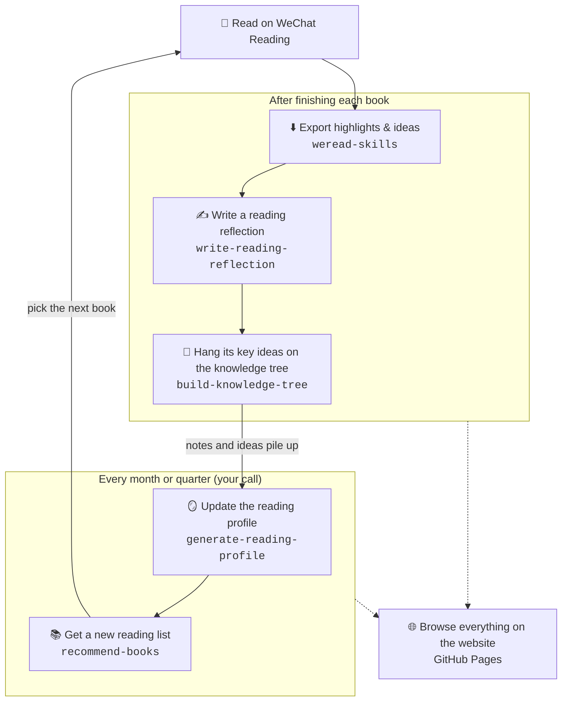

# Personal Librarian

An AI-agent-driven personal librarian that works with [WeChat Reading (微信读书)](https://weread.qq.com/): export your reading notes, write reading reflections, analyze your reading taste, build a personal reading profile, and discover books you'll love.

## Features

- **Export reading notes** — pull your highlights, ideas, and bookmarks from WeChat Reading into Markdown files you own.
- **Write reading reflections** — turn raw notes into structured reading reviews (心得) with the help of an AI agent.
- **Reading profile** — analyze your notes, bookshelf, and reading stats to generate a personal reading taste profile (偏好画像).
- **Personalized recommendations** — discover new books based on your profile and interests.
- **Knowledge tree** — sort the books you have read into domains and hang the key ideas you took from each one on a tree (知识树).
- **Website** — browse your bookshelf, notes, reflections, reading profile, recommendations, and knowledge tree on GitHub Pages.

## How it works

The project is driven by an AI coding agent (e.g., Claude Code) with the [weread-skills](https://github.com/Tencent/WeChatReading) skill installed. You ask for something in natural language — "export my highlights from 三体", "summarize my reading this month", "recommend me a book" — and the agent calls the WeChat Reading API, processes the results, and writes the output into this repository.

## Workflow

Personal Librarian turns reading into a loop of personal growth. Read on WeChat Reading; after each book, pull its notes, write a reflection, and hang what you learned on your knowledge tree. Every month or quarter (you pick the rhythm), refresh your reading profile and let it recommend the next books to read.



## Prerequisites

- An AI coding agent with skill support (e.g., [Claude Code](https://claude.com/claude-code))
- A WeChat Reading API key (`wrk-xxxxxxxx`)

## Setup

1. Install the WeChat Reading skill globally:

   ```bash
   npx skills add Tencent/WeChatReading -g
   ```

2. Install this project's skills globally (`write-reading-reflection` turns your notes and spoken reflections into a 读书心得; `generate-reading-profile` snapshots your WeChat Reading stats and drafts your reading profile 阅读画像; `recommend-books` curates a monthly reading list 好书推荐 verified on WeChat Reading; `build-knowledge-tree` sorts your books into a knowledge tree 知识树 of domains and key ideas):

   ```bash
   npx skills add cedar-ai-project/personal-librarian -g
   ```

3. Set your WeChat Reading API key:

   ```bash
   export WEREAD_API_KEY=<your_api_key>
   ```

   Add the same line to your shell profile (`~/.zshrc` or `~/.bashrc`) to persist it across sessions.

4. Skills are installed as a snapshot — changes to the source repository are not synced automatically. To update installed skills after the repository changes (make sure your changes are pushed to GitHub first):

   ```bash
   npx skills update -g                    # update all global skills
   npx skills update write-reading-reflection -g # or update a single skill
   ```

## Repository layout

| Directory | Purpose |
| --------- | ------- |
| `notes/` | Exported highlights and ideas. One subdirectory per book, e.g. `notes/投资第1课/` |
| `reflections/` | Reading reflections (心得). One subdirectory per book |
| `profile/` | Reading profile: `reading-stats.json` (WeChat Reading stats snapshot) and `阅读画像.md` (AI-written profile), both produced by `generate-reading-profile` |
| `knowledge/` | Knowledge tree (`知识树.md`): domains → subdomains → books → key ideas; produced by `build-knowledge-tree` |
| `recommendations/` | Reading lists (好书推荐), one file per issue (e.g. `2026-11.md`), plus `shelf-status.json`; produced by `recommend-books` |
| `skills/` | Agent skills bundled with this project (`write-reading-reflection`, `generate-reading-profile`, `recommend-books`, `build-knowledge-tree`) |
| `site/` | Source of the GitHub Pages website |

## Website

Browse the bookshelf, highlights, ideas, reflections, reading profile, book recommendations, and knowledge tree online at <https://cedar-ai-project.github.io/personal-librarian/>. The site has four pages, with light and dark themes:

### 书架 · Bookshelf

Every book as a cover card, with search and a finished / still-reading filter. Open a book to read its reflection (读书心得) and all its highlights and ideas (划线与想法), with a table of contents.

<!-- TODO: add a screenshot of the bookshelf page -->


### 阅读画像 · Reading profile

An AI-written reading persona with keywords, core themes, how your thinking changed year by year, and favourite quotes, next to charts of your WeChat Reading stats: reading time per year and per hour of day, favourite categories, and the books you spent longest on.

<!-- TODO: add a screenshot of the reading profile page -->


### 好书推荐 · Book recommendations

A monthly or quarterly reading list verified on WeChat Reading, grouped by why each book is recommended, with ratings, a personal reason that links back to the books you have read, and whether a book is already on your shelf or read.

<!-- TODO: add a screenshot of the book recommendations page -->


### 知识树 · Knowledge tree

Your books drawn as a tree growing from its roots: each domain is a branch (the domains with the most books sit nearest the root), each book a twig carrying its cover, and each knowledge point a leaf. Click a leaf for its explanation, a link to the original note, and the other books where the same idea appears.

<!-- TODO: add a screenshot of the knowledge tree page -->


### How the site is built

The site lives in `site/` (Vue 3 + Vite + Vuetify). It is rebuilt from `notes/`, `reflections/`, `profile/`, `recommendations/`, and `knowledge/`, and deployed by `.github/workflows/deploy-site.yml` on every push to `main` that touches them or `site/`. Each book's `cover.jpg` is shown on the bookshelf. For books that only have a reflection, an optional `reflections/<book>/meta.json` (`{ "author": "...", "link": "...", "readAt": "YYYY-MM-DD" }`) supplies the author, WeChat Reading link, and when the book was finished (for books not read on WeChat Reading; `YYYY-MM` also works). A book counts as finished (读完) when it has a reflection; to mark a book finished before writing one, add `notes/<book>/meta.json` with `{ "finished": true }`. The 阅读画像 page is built from `profile/`, the 好书推荐 page from `recommendations/`, and the 知识树 page from `knowledge/`.

To preview locally (Node.js 20+, Python 3 with `pip install fonttools brotli`):

```bash
cd site
npm install
npm run build && npm run preview   # or `npm run font` once, then `npm run dev`
```

## License

This project is **not** licensed for commercial use.

- **Code** (`site/`, `skills/`, and other software): [PolyForm Noncommercial License 1.0.0](LICENSE) — free for personal, study, and other noncommercial use; any commercial use requires the author's written permission.
- **Original writing** (reading reflections, reading profile, knowledge tree, recommendations, and the author's own ideas in the notes): [CC BY-NC-ND 4.0](LICENSE-CONTENT) — share with attribution, no commercial use, no derivatives.
- **Book excerpts and covers** are not licensed: their copyright belongs to the original authors, translators, and publishers.

See [NOTICE.md](NOTICE.md) for exactly which files fall under which terms. Earlier versions released under the Apache License 2.0 remain under Apache 2.0.

## Star History

[](https://www.star-history.com/#cedar-ai-project/personal-librarian&Timeline)
