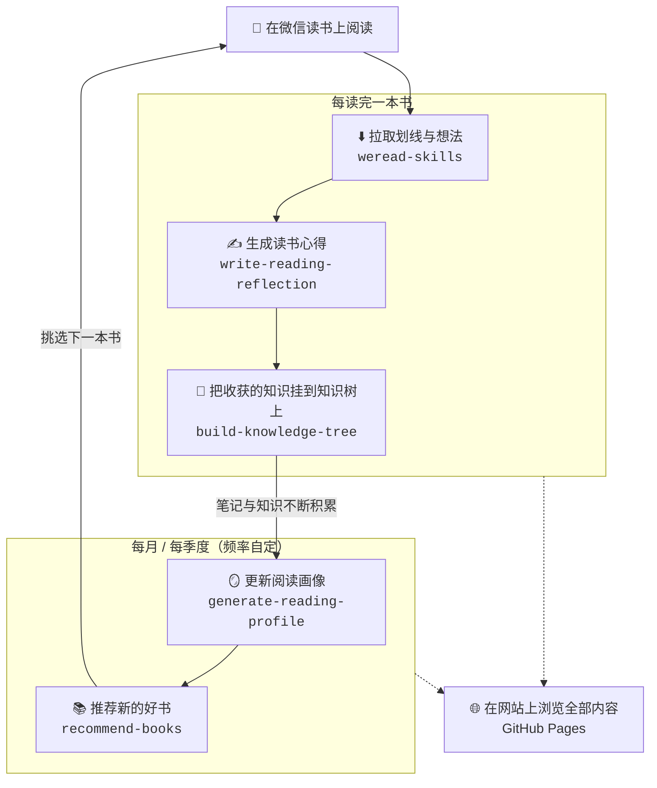

# Personal Librarian（个人图书管理员）

一个 AI agent 驱动的个人图书管理员，与[微信读书](https://weread.qq.com/)深度集成：导出读书笔记、写读书心得、分析个人读书喜好、生成阅读画像，并根据个人兴趣推荐好书。

## 功能

- **导出读书笔记** —— 把微信读书中的划线、想法和书签导出为你自己拥有的 Markdown 文件。
- **写读书心得** —— 在 AI agent 的帮助下，把原始笔记整理成结构化的读书心得。
- **阅读画像** —— 分析笔记、书架和阅读统计数据，生成个人读书喜好画像。
- **个性化推荐** —— 根据你的画像和兴趣发现新书。
- **知识树** —— 把读过的书按领域分类，并把从每本书中收获的核心知识点挂到知识树上。
- **网站** —— 在 GitHub Pages 上浏览书架、笔记、读书心得、阅读画像、好书推荐和知识树。

## 工作原理

项目由 AI 编码 agent（如 Claude Code）驱动，依赖 [weread-skills](https://github.com/Tencent/WeChatReading) skill。你用自然语言提出需求——"导出我在三体里的划线"、"总结一下我这个月的阅读"、"给我推荐一本书"——agent 就会调用微信读书 API、处理结果，并把产出写入本仓库。

## 工作流

Personal Librarian 把阅读变成一个个人成长与发展的循环：在微信读书上阅读；每读完一本书，拉取笔记、写读书心得，并把收获的知识挂到知识树上；每月或每季度（频率由你决定）更新一次阅读画像，再根据画像推荐接下来值得读的好书。



## 前置条件

- 支持 skill 的 AI 编码 agent（如 [Claude Code](https://claude.com/claude-code)）
- 微信读书 API Key（`wrk-xxxxxxxx`）

## 配置方法

1. 全局安装微信读书 skill：

   ```bash
   npx skills add Tencent/WeChatReading -g
   ```

2. 全局安装本项目自带的 skill（`write-reading-reflection` 可根据划线与想法和口述感悟自动生成读书心得；`generate-reading-profile` 可拉取微信读书阅读统计快照并起草阅读画像；`recommend-books` 可精选并经微信读书核实，生成一期好书推荐书单；`build-knowledge-tree` 可把读过的书按领域和知识点整理成知识树）：

   ```bash
   npx skills add cedar-ai-project/personal-librarian -g
   ```

3. 设置微信读书 API Key：

   ```bash
   export WEREAD_API_KEY=<your_api_key>
   ```

   把同一行加入你的 shell 配置文件（`~/.zshrc` 或 `~/.bashrc`），以便跨会话持久生效。

4. skill 安装的是源仓库的一份快照，仓库后续更新不会自动同步。更新已安装的 skill：

   ```bash
   npx skills update -g                    # 更新所有全局 skill
   npx skills update write-reading-reflection -g # 或只更新指定 skill
   ```

## 仓库结构

| 目录 | 用途 |
| ---- | ---- |
| `notes/` | 导出的划线和想法。每本书一个子目录，如 `notes/投资第1课/` |
| `reflections/` | 读书心得。每本书一个子目录 |
| `profile/` | 阅读画像：`reading-stats.json`（微信读书统计快照）和 `阅读画像.md`（AI 撰写的画像），均由 `generate-reading-profile` 生成 |
| `knowledge/` | 知识树（`知识树.md`）：领域 → 子领域 → 书 → 知识点；由 `build-knowledge-tree` 生成 |
| `recommendations/` | 好书推荐书单，每期一个文件（如 `2026-11.md`），以及 `shelf-status.json`；由 `recommend-books` 生成 |
| `skills/` | 本项目自带的 agent skill（`write-reading-reflection`、`generate-reading-profile`、`recommend-books`、`build-knowledge-tree`） |
| `site/` | GitHub Pages 网站源码 |

## 在线浏览

在 <https://cedar-ai-project.github.io/personal-librarian/> 在线浏览书架、划线、想法、读书心得、阅读画像、好书推荐和知识树。网站共有 4 个页面，支持亮色和暗色模式：

### 书架

所有书以封面卡片展示，支持搜索，可按「读完 / 在读」筛选。点开一本书，可以阅读它的读书心得以及全部划线与想法，并带有章节目录。

<!-- TODO: 补充书架页面的截图 -->


### 阅读画像

AI 撰写的阅读人格、关键词、核心关注主题、逐年的思想变化轨迹和金句，配合微信读书阅读统计图表：逐年阅读时长、24 小时阅读时段、偏好分类，以及读得最久的书。

<!-- TODO: 补充阅读画像页面的截图 -->


### 好书推荐

每月或每季度一期、经微信读书核实的书单，按推荐动机分组，附评分、关联已读书籍的个性化推荐理由，并标注是否已在书架或已读。

<!-- TODO: 补充好书推荐页面的截图 -->


### 知识树

把读过的书画成一棵从树根生长的树：每个领域是一根主枝（书越多的领域越靠近树根），每本书是挂着封面的枝杈，每个知识点是一片叶子。点击叶子，可以查看知识点的解释、跳转到笔记原文，并看到同一知识点还出现在哪些书中。

<!-- TODO: 补充知识树页面的截图 -->


### 网站的构建方式

网站源码位于 `site/`（Vue 3 + Vite + Vuetify）。每次向 `main` 推送 `notes/`、`reflections/`、`profile/`、`recommendations/`、`knowledge/` 或 `site/` 的改动时，`.github/workflows/deploy-site.yml` 会重新构建并部署网站。书架会展示每本书的 `cover.jpg`。对于只有读书心得的书，可以在 `reflections/<书名>/meta.json`（`{ "author": "...", "link": "...", "readAt": "YYYY-MM-DD" }`）中补充作者、微信读书链接，以及读完日期（用于不在微信读书上读的书，也可以只写到 `YYYY-MM`）。有读书心得的书会显示为「读完」；若想在写心得之前就标记为读完，可以添加 `notes/<书名>/meta.json`，内容为 `{ "finished": true }`。「阅读画像」页面由 `profile/` 生成，「好书推荐」页面由 `recommendations/` 生成，「知识树」页面由 `knowledge/` 生成。

本地预览（需要 Node.js 20+，以及安装了 `pip install fonttools brotli` 的 Python 3）：

```bash
cd site
npm install
npm run build && npm run preview   # 或先执行一次 `npm run font`，再 `npm run dev`
```

## 许可证

本项目**不允许**用于商业目的。

- **代码**（`site/`、`skills/` 及其他软件部分）：[PolyForm Noncommercial License 1.0.0](LICENSE)——可免费用于个人学习、研究等非商业用途，任何商业使用都需取得作者书面许可。
- **原创文字**（读书心得、阅读画像、知识树、好书推荐，以及笔记中作者本人的想法）：[CC BY-NC-ND 4.0](LICENSE-CONTENT)——转载须署名，不得商用，不得修改。
- **书中摘录与书籍封面**不在授权范围内，版权归原作者、译者和出版社所有。

各文件具体适用的条款见 [NOTICE.md](NOTICE.md)。以 Apache License 2.0 发布的早期版本仍适用 Apache 2.0。
